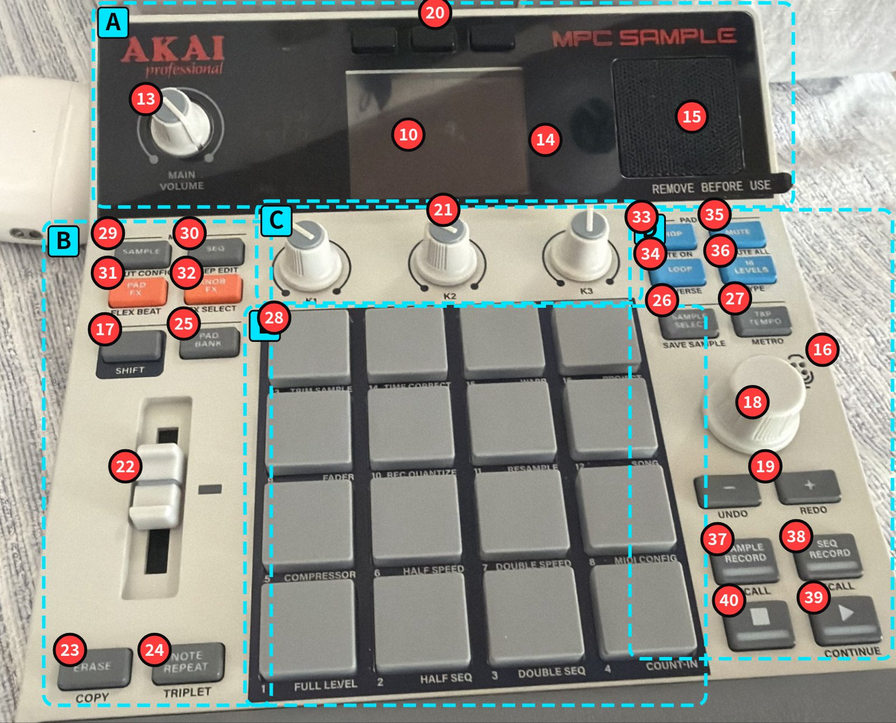

# MPC Sample 图文教程

Akai Professional **MPC Sample（型号 AC50，2026 年 3 月上市）** 的中文图文教程，以 GitHub Pages 网站形式发布。暗色 hip-hop 风格，内容依据官方 User Guide v1.3.0 核对。

**在线阅读：** `https://<user>.github.io/mpc-sample-tutorial/`（把 `<user>` 换成你的 GitHub 用户名）

也可以直接在 github.com 上阅读 Markdown：从 [`index.md`](index.md) 开始，或进入 [`chapters/`](chapters/)。



## 目录

| 章节 | 状态 |
|---|---|
| [第一章 功能与特点](chapters/01-functions.md) | 已完成 |
| [第二章 打击乐音色、使用场景、写 beat](chapters/02-drums-and-beats.md) | 写作中 |
| [第三章 采样、速度节奏、beat 风格](chapters/03-sampling-tempo-styles.md) | 写作中 |
| [第四章 每个界面的每个旋钮与按键](chapters/04-controls-reference.md) | 写作中 |
| [第五章 术语表（英中 / 英日）](chapters/05-glossary.md) | 已完成 |

## 发布到 GitHub Pages

本仓库是纯 Jekyll 站点，GitHub Pages 原生构建，**不需要 Actions**：

1. 推送到 GitHub 仓库 `mpc-sample-tutorial`。
2. 仓库 **Settings → Pages → Build and deployment**：Source 选 **Deploy from a branch**，Branch 选 **`main`**，目录 **`/ (root)`**。
3. 几分钟后即可访问 `https://<user>.github.io/mpc-sample-tutorial/`。

> 如果仓库名不是 `mpc-sample-tutorial`，请修改 `_config.yml` 里的 `baseurl`（用户站点 `<user>.github.io` 则设为 `""`）。

## 目录结构

```
_config.yml              站点配置（title / lang / baseurl）
_layouts/default.html    唯一布局：页头导航、标注图替换、翻页
_includes/
  outline.html           全书大纲（自动循环 site.pages）
  pager.html             上一章 / 下一章
  figures/*.html         内联 SVG 标注图（由 tools/build_figures.py 生成）
_data/                   标注坐标：markers / regions / legend / pads / callouts
assets/css/style.css     暗色 hip-hop 样式
assets/js/site.js        术语表切换（三语 / 英中 / 英日）、编号圆点
assets/img/              照片与官方产品图；annotated/ 为标注图位图（github.com 浏览用）
chapters/NN-*.md         各章正文
index.md                 封面
tools/build_figures.py   从 _data 生成标注图（SVG + JPG）
```

## 如何新增章节

1. 在 `chapters/` 新建一个 Markdown 文件，例如 `chapters/06-live-tips.md`。
2. 文件开头写前言字段（front matter）：

   ```yaml
   ---
   title: "第六章 现场演出技巧"
   chapter: 6
   nav_order: 6
   short_title: "现场演出"     # 顶部导航显示的短名
   status: draft              # done = 已完成，draft = 大纲 / 写作中
   outline:                   # 封面“全书大纲”里列出的小节
     - "6.1 ……"
     - "6.2 ……"
   ---
   ```

3. 正文用普通 Markdown 写。图片用相对路径，例如 ``，这样在 github.com 和网站上都能显示。
4. 完成。顶部导航、封面大纲和上一章/下一章会按 `nav_order` 自动更新，不需要改任何其他文件（可顺手更新本 README 的目录表）。

### 标注图（可选）

- 标注点坐标在 `_data/*.yml`，坐标系是照片 `assets/img/mpc-sample-top.jpg`（1536×1240，即原照片裁掉顶部 200px）。
- 修改后运行 `python3 tools/build_figures.py`（需要 `pyyaml`、`pillow` 和 Google Chrome），会同时更新 `_includes/figures/*.html`（网站用内联 SVG）和 `assets/img/annotated/*.jpg`（github.com 用）。
- 在 Markdown 里插图：前言加 `figures: [fig-a]`，正文写

  ```html
  <!-- figure:fig-a -->
  <p class="gh-only"></p>
  ```

  网站上注释会被替换成内联 SVG，`gh-only` 的位图仅在 github.com 上显示。

## 本地预览（可选）

```bash
bundle install
bundle exec jekyll serve
# 打开 http://127.0.0.1:4000/mpc-sample-tutorial/
```

## 图片来源

- 正面照片：作者本人的机器。
- 后面板与侧面照片：Akai Professional 官方产品图（[akaipro.com](https://www.akaipro.com/mpc-sample/)），版权归 Akai Professional / inMusic 所有，仅作教学说明引用。
