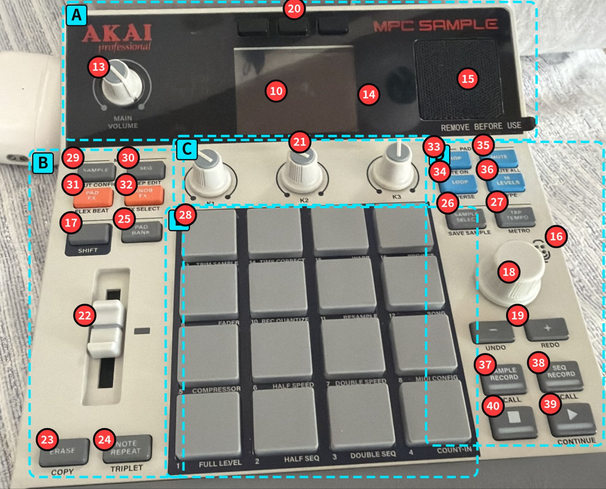
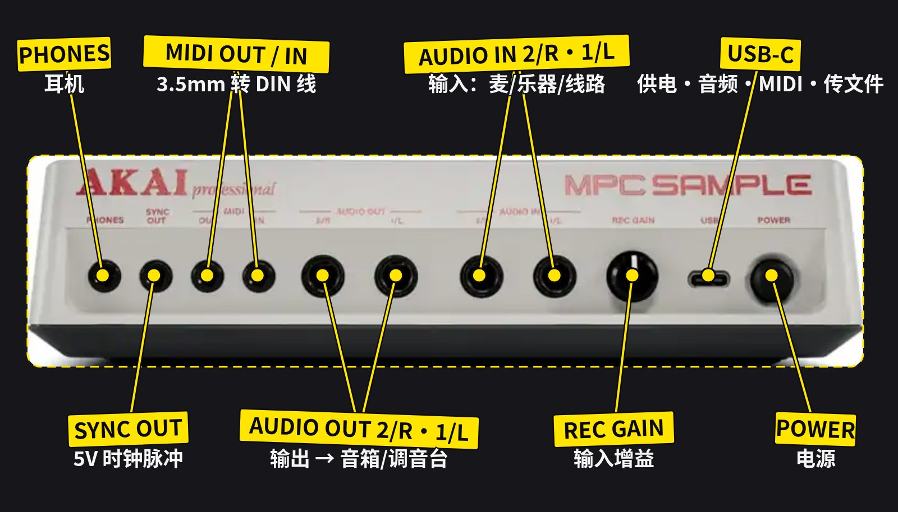
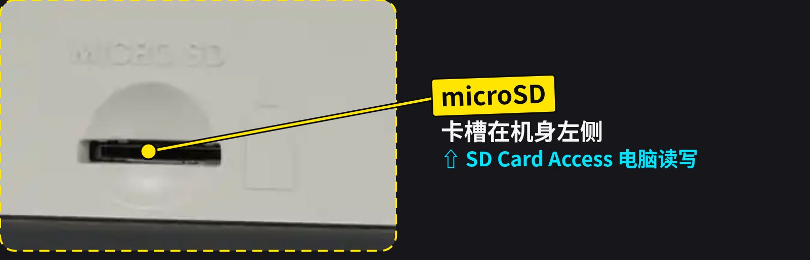
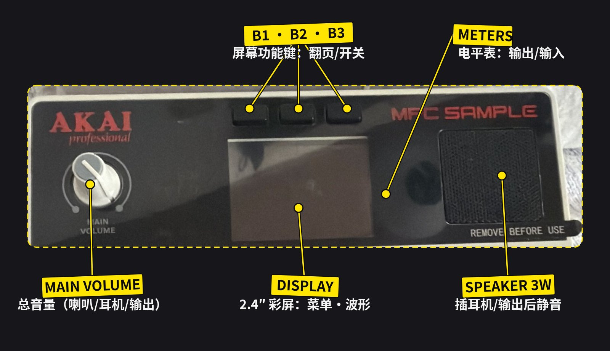
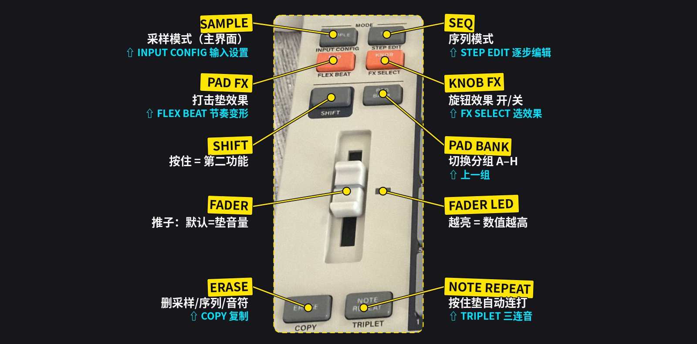
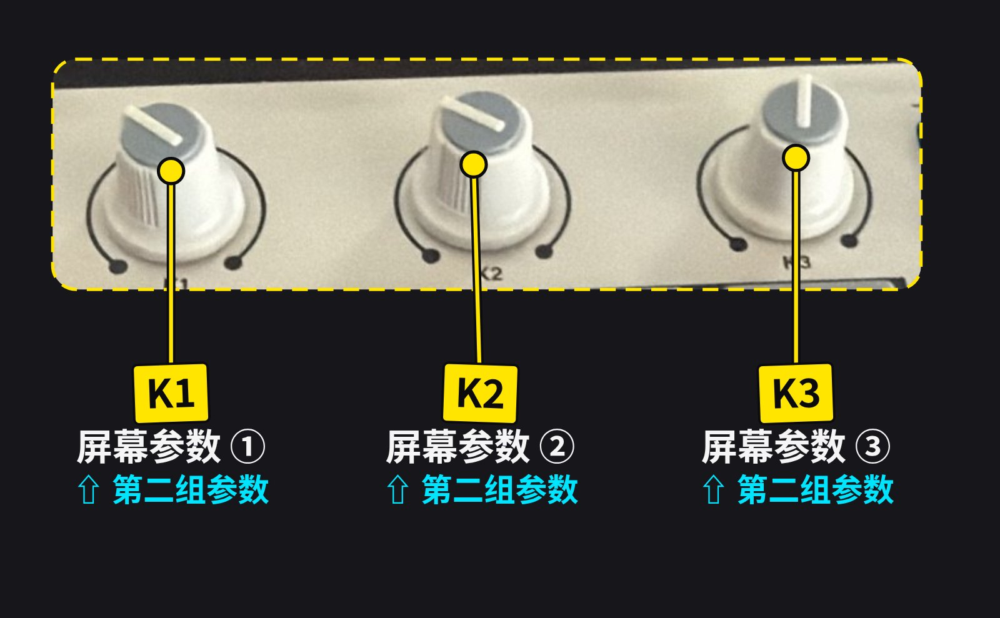
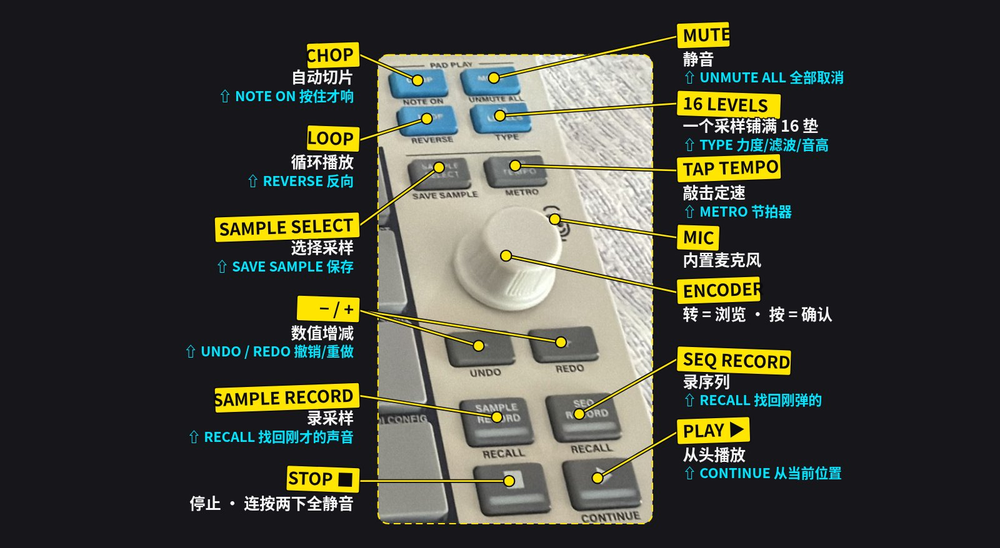
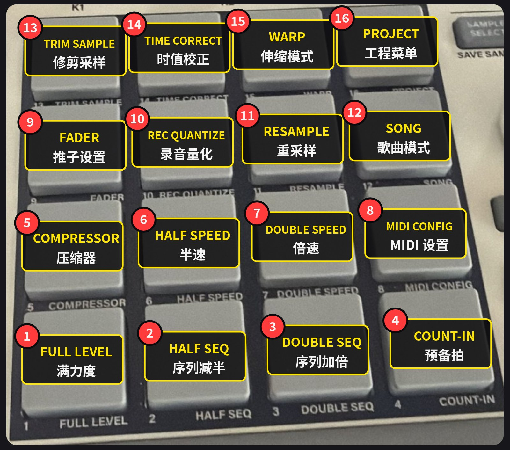

# 第一章 功能与特点

AKAI PROFESSIONAL · AC50 手册 v1.3.0 核对 第一章 已完成

**本章目录：**
[1.1 机器定位](#s1-1) ·
[1.2 规格](#s1-2) ·
[1.3 面板全图解](#s1-3) ·
[1.4 后面板与侧面](#s1-4) ·
[1.5 顶部面板控件](#s1-5) ·
[1.6 16 垫 SHIFT 功能](#s1-6) ·
[1.7 灯光含义](#s1-7) ·
[1.8 全部屏幕/模式](#s1-8) ·
[1.9 五分钟上手](#s1-9) ·
[1.10 待确认](#s1-10)

## 1.1 这是什么机器

| 类别 | 说明 |
|---|---|
| SAMPLER | 采样器：麦克风 / 后面板 / USB / Resample |
| SEQUENCER | 音序器：128 序列，1–128 小节 |
| FX | 4 引擎：Pad FX · Flex Beat · Knob FX · Compressor |
| STANDALONE | 电池 + 喇叭 + 麦，不用电脑 |

MPC 系列始于 1988 年的 MPC60。MPC Sample 是其中最小、最便宜的一台，外观致敬 MPC60，沿用“采样 → 放到垫上 → 录成序列”的流程。

与大型 MPC 不同，手册中没有 Program 和 Track：一个工程 = 8 组 × 16 垫 = 128 采样，加 128 个序列，再用 Song Mode 串成整首歌。

灯光规则：明亮 = 使用中，暗亮 = 可用，熄灭 = 不可用；按住 SHIFT 时有第二功能的键亮红灯。序列垫：浅绿 = 有内容，亮绿 = 播放中，闪烁 = 排队。

## 1.2 规格

| 数值 | 说明 |
|---|---|
| 16 | RGB 打击垫 · 力度+触后 |
| 32 | 立体声复音 |
| 128 | 采样 / 工程（8 组 × 16） |
| 128 | 序列 / 工程 |
| 8 GB | 内部存储 + microSD |
| 2 GB | 内存 |
| 20 min | 单个采样最长 |
| 24-bit | 44.1 kHz 录音 |
| 60 | 效果（4 个引擎） |
| 960 | PPQN 时间分辨率 |
| ≈5 h | 电池（FAQ 写 6 h） |
| 0.92 kg | 19.4 × 23.6 × 5.0 cm |

导入：WAV · MP3 · AIFF · FLAC · OGG · SND · S1S · S3S。附件：USB-C 线、快速入门指南。

## 1.3 面板全图解（A–F 分区）

<!-- figure:overview -->

<ul class="chips">
<li><a href="#region-a"><b>A</b>顶部：音量·屏幕·喇叭</a></li>
<li><a href="#region-b"><b>B</b>左列：模式·SHIFT·推子</a></li>
<li><a href="#region-c"><b>C</b>K1–K3 旋钮</a></li>
<li><a href="#region-d"><b>D</b>右列：PAD PLAY·走带</a></li>
<li><a href="#region-e"><b>E</b>16 垫 + SHIFT</a></li>
<li><a href="#region-f"><b>F</b>后面板 + microSD</a></li>
</ul>

### 面板编号 1–40

| # | 控件 | 说明 |
|---|---|---|
| 1 | POWER | 电源 |
| 2 | USB-C | 供电·音频·MIDI |
| 3 | REC GAIN | 录音增益 |
| 4 | AUDIO IN | 输入 L/R |
| 5 | AUDIO OUT | 输出 L/R |
| 6 | MIDI IN/OUT | 3.5mm MIDI |
| 7 | SYNC OUT | 时钟同步 |
| 8 | PHONES | 耳机 |
| 9 | microSD | 左侧卡槽 |
| 10 | DISPLAY | 屏幕 |
| 11 | BATTERY | 电池图标 |
| 12 | CHARGING | 充电图标 |
| 13 | MAIN VOLUME | 总音量 |
| 14 | METERS | 电平表 |
| 15 | SPEAKER | 扬声器 |
| 16 | MIC | 内置麦克风 |
| 17 | SHIFT | 第二功能 |
| 18 | ENCODER | 编码器 |
| 19 | − / + | 增减·撤销/重做 |
| 20 | B1–B3 | 屏幕功能键 |
| 21 | K1–K3 | 参数旋钮 |
| 22 | FADER | 推子 |
| 23 | ERASE | 删除·复制 |
| 24 | NOTE REPEAT | 连打·三连音 |
| 25 | PAD BANK | 分组 A–H |
| 26 | SAMPLE SELECT | 选采样·保存 |
| 27 | TAP TEMPO | 定速·节拍器 |
| 28 | PADS | 16 打击垫 |
| 29 | SAMPLE | 采样模式 |
| 30 | SEQ | 序列模式 |
| 31 | PAD FX | 垫效果·Flex Beat |
| 32 | KNOB FX | 旋钮效果 |
| 33 | CHOP | 切片·Note On |
| 34 | LOOP | 循环·反向 |
| 35 | MUTE | 静音 |
| 36 | 16 LEVELS | 16 级 |
| 37 | SAMPLE RECORD | 录采样·回溯 |
| 38 | SEQ RECORD | 录序列·回溯 |
| 39 | PLAY | 播放·继续 |
| 40 | STOP | 停止 |

照片：你的机器。编号沿用官方手册 Features 章。11、12、14 为指示灯，照片中未亮，位置依官方线稿。⇧ = 按住 SHIFT。

## 1.4 后面板与侧面

### FRear · 后面板 · 侧面

<!-- figure:fig-f -->

<!-- figure:fig-side -->

后面板与侧面照片：Akai 官方产品图（akaipro.com）。

**详细说明**

| # | 接口 | 规格 / 作用 |
|---|---|---|
| 1 | POWER | 开关机 |
| 2 | USB-C | 供电充电（建议 5V 2A）· 音频/MIDI 收发 · microSD 读写；视线材电源可能只在关机时充电 |
| 3 | REC GAIN | AUDIO IN 录音电平 |
| 4 | AUDIO IN ×2 | 6.35mm TRS：麦克风 / 乐器 / 线路 |
| 5 | AUDIO OUT ×2 | 6.35mm TRS 线路输出，MAIN VOLUME 控制 |
| 6 | MIDI OUT / IN | 3.5mm TRS Type A，需转 5 针 DIN（另购） |
| 7 | SYNC OUT | 5V CV 时钟，接模块合成器 |
| 8 | PHONES | 3.5mm TRS；插入后扬声器关闭 |
| 9 | microSD | 左侧；Project → SD Card Access |

## 1.5 顶部面板控件

### ATop · 顶部区域

<!-- figure:fig-a -->

**详细说明**

| 控件 | 作用 |
|---|---|
| MAIN VOLUME | 同时控制扬声器、PHONES、AUDIO OUT |
| B1 / B2 / B3 | 屏幕上方三键：切换页面或开关功能，随模式变化 |
| DISPLAY | 2.4″ 彩屏：底部 3 项 = K1–K3，顶部 3 项 = B1–B3 |
| METERS | 平时显示输出电平，录音时显示输入电平；持续红色 → 调低 REC GAIN |
| SPEAKER | 3W；接耳机或 AUDIO OUT 时不响；用内置麦录音时自动静音防啸叫 |
| 电池图标 | 绿 100–30% · 琥珀 29–15% · 红 14–5% · 红闪 <5% |
| 充电图标 | 充电中亮；充满或未接电时熄灭 |
| Bank 指示 | 当前分组 A–H 显示在 MAIN VOLUME 旁 |

### BLeft · 左列

<!-- figure:fig-b -->

**详细说明**

| 控件 | 按下 | ⇧ SHIFT + |
|---|---|---|
| SAMPLE | Sample Mode：触发/编辑采样 | INPUT CONFIG 输入设置 |
| SEQ | Sequence Mode：选/录/编辑序列 | STEP EDIT 逐步编辑 |
| PAD FX | 垫触发整体效果，压力 = 效果量 | FLEX BEAT 切碎/搓碟/门限 |
| KNOB FX | K1–K3 专控一个效果 | FX SELECT 选效果与作用垫 |
| SHIFT | 按住访问按键下方的第二功能 | — |
| PAD BANK | 循环 A–H；按住 + PAD 1–8 直达 | 上一组 |
| FADER | 默认垫音量；Step Edit 中微调时值；LED 亮度 = 数值 | ⇧+PAD 9 改参数 |
| ERASE | +垫：删采样 / 播放中删音符 / Seq 中删序列；+旋钮：删自动化 | COPY 复制采样或序列 |
| NOTE REPEAT | 按住垫按时值连打；B1–B3 选时值；可按住临时开启 | TRIPLET 三连音时值 |

小技巧：按住 SEQ 再按 SAMPLE = Sample/Seq 组合模式（屏幕看序列，垫打采样）。

### CKnobs · K1–K3

<!-- figure:fig-c -->

> 注意
>
> 旋钮是绝对位置式。参数名旁出现箭头 → 朝箭头方向转，箭头消失即接管。

### DRight · 右列

<!-- figure:fig-d -->

**详细说明**

| 控件 | 按下 | ⇧ SHIFT + |
|---|---|---|
| CHOP | 自动切片（默认 Threshold），各垫触发一片；再按回到 Trim | NOTE ON：按住才响 |
| LOOP | 在 Loop 点与 End 之间循环；再按垫停止 | REVERSE 反向 |
| MUTE | 垫变静音开关（红 = 静音，黄 = 正常）；任何模式可用 | UNMUTE ALL |
| 16 LEVELS | 当前采样铺到 16 垫并逐级变化 | TYPE：Velocity / Filter / Tune（原音高在 PAD 4） |
| SAMPLE SELECT | 采样浏览器 | SAVE SAMPLE |
| TAP TEMPO | 敲击定速；按住 + ENCODER 调 BPM | METRO：Off / On / Record |
| MIC | 内置电容麦克风 | — |
| ENCODER | 转：浏览/调值；按：确认 | — |
| − / + | 减 / 加，列表上下 | UNDO / REDO |
| SAMPLE RECORD | 进入采样录音 | RECALL 找回最近输入音频 |
| SEQ RECORD | 待录（闪烁），再按 PLAY 开录 | RECALL 找回上一轮弹奏 |
| PLAY | 从头播放/录音 | CONTINUE 从播放头继续 |
| STOP | 停止；连按两下停止所有声音 | — |

## 1.6 16 垫 SHIFT 功能

### EPads · 16 打击垫 · ⇧ 功能

<!-- figure:fig-e -->

| PAD | ⇧ SHIFT + 垫 | 中文 |
|---|---|---|
| 1 | FULL LEVEL | 满力度 |
| 2 | HALF SEQ | 序列减半 |
| 3 | DOUBLE SEQ | 序列加倍 |
| 4 | COUNT-IN | 预备拍 |
| 5 | COMPRESSOR | 压缩器 |
| 6 | HALF SPEED | 半速 |
| 7 | DOUBLE SPEED | 倍速 |
| 8 | MIDI CONFIG | MIDI 设置 |
| 9 | FADER | 推子设置 |
| 10 | REC QUANTIZE | 录音量化 |
| 11 | RESAMPLE | 重采样 |
| 12 | SONG | 歌曲模式 |
| 13 | TRIM SAMPLE | 修剪采样 |
| 14 | TIME CORRECT | 时值校正 |
| 15 | WARP | 伸缩模式 |
| 16 | PROJECT | 工程菜单 |

16 垫：力度感应 + 复音触后。按住 SHIFT 再按垫 = 上面的功能。

## 1.7 灯光含义

- 灯光规则：明亮 = 使用中，暗亮 = 可用，熄灭 = 不可用；按住 SHIFT 时有第二功能的键亮红灯。序列垫：浅绿 = 有内容，亮绿 = 播放中，闪烁 = 排队。
- 电池图标：绿 100–30% · 琥珀 29–15% · 红 14–5% · 红闪 <5%
- 充电图标：充电中亮；充满或未接电时熄灭
- FADER LED：越亮 = 数值越高
- MUTE：垫变静音开关（红 = 静音，黄 = 正常）；任何模式可用
- METERS：平时显示输出电平，录音时显示输入电平；持续红色 → 调低 REC GAIN

## 1.8 所有屏幕 / 模式

#### SAMPLE MODE · 采样模式（主界面）

进入：SAMPLE

| 控件 | 作用 |
|---|---|
| B1 → Trim | K1 Start · K2 End · K3 Loop（⇧ 缩放波形） |
| B1 → Mix | K1 Volume · K3 Pan（⇧K2 Kit Volume 整组音量） |
| B1 → Amp Env | K1 Attack · K2 Decay/Release · K3 Vel Sens（⇧K2 Decay From） |
| B2 → Tune | K1 Semi ±24 · K2 Fine ±90 · K3 Warp（⇧K3 # Beats） |
| B2 → Play | K1 Mono/Poly · K2 Mute Group · K3 Offset（⇧K2 Pad Link） |
| B3 → Filter | K1 Cutoff · K2 Reso · K3 Type（Classic/LPF/HPF/BPF） |
| B3 → Filt Env | K1 Attack · K2 Decay/Release · K3 Depth |
| ⇧B1 / ⇧B2 | Loop Lock / Normalize 归一化 |

#### CHOP · 切片

进入：SAMPLE 模式中按 CHOP

| 控件 | 作用 |
|---|---|
| K1 / K2 | 切片起点 / 终点 |
| K3 | Threshold · Regions 4/8/16 · Manual（最多 16 片） |
| ⇧K3 | Threshold 值（越高片越少） |
| ⇧B1 / ⇧B2 / ⇧B3 | Extract 提取 / Split 拆分 / Merge 合并 |
| ERASE + 垫 | 删除该切片 |

#### SAMPLE SELECT · 采样浏览 / 保存

进入：SAMPLE SELECT（⇧ = SAVE SAMPLE）

| 控件 | 作用 |
|---|---|
| ENCODER | 转：浏览 · 按：打开/载入 |
| B1 / B2 / B3 | 返回 / 内部↔microSD / 自动试听 |
| 保存页 | ENCODER 选字符 · B2 删除 · B3 Do It! |

#### SAMPLE RECORD · 采样录音

进入：SAMPLE RECORD

| 控件 | 作用 |
|---|---|
| B1 | Monitor：Off / Auto / On |
| K1 | Source：Mic · Rear · Rear L/R · Resample · USB · USB L/R |
| K2 | 长度：Free / Seq |
| K3 | Threshold 自动触发电平 |
| 打击垫 | 按一下开始，再按停止；录音中按其他垫可打切点 |

#### SEQUENCE MODE · 序列模式

进入：SEQ

| 控件 | 作用 |
|---|---|
| 按住 B1 + ENCODER | BPM |
| B2 / B3 | SEQ↔GBL 速度 / 录音量化 |
| K1 / K2 / K3 | 小节数 1–128 / Q 量化值 / RT Swing |
| ⇧K2 / ⇧K3 | 拍号 / 节拍器音量 |
| SEQ RECORD → PLAY | 开始录；循环后自动叠录 |
| 打击垫 | 选择 / 排队播放序列 |

#### STEP EDIT · 逐步编辑

进入：⇧ + SEQ

| 控件 | 作用 |
|---|---|
| ENCODER | 按 Q 值逐步移动 |
| − / + 或垫 | 选择事件 |
| FADER | 前后微调时值 |
| K1 / K2 / K3 | 长度 / Q / 力度 |
| B3 | 删除事件 |

#### SONG MODE · 歌曲模式

进入：⇧ + PAD 12

| 控件 | 作用 |
|---|---|
| 垫 + B3 | 插入序列 |
| B2 | 删除序列 |
| B1 → B2 / B3 | 导出音频 / 导出为新序列 |

#### PAD FX · 打击垫效果

进入：PAD FX

| 控件 | 作用 |
|---|---|
| PAD 1–16 | Half Speed · Chorus · Flanger · Phaser · Comb · LP · HP · BP · Ring Mod · LoFi · Color · Granulator · Beat Repeat · Rev Stepper · Delay · Reverb |
| 压力 | 按得越重效果越强（最多 4 个同时） |
| K1–K3 / B1 | 效果参数 / Latch 锁定 |

#### FLEX BEAT · 节奏变形

进入：⇧ + PAD FX

| 控件 | 作用 |
|---|---|
| PAD 1 | Empty 原声 |
| PAD 2–16 | 切碎 · 搓碟 · 门限等（各垫名称待确认） |
| K1 / K3 / B3 | One Shot↔Loop / Mix / Quantize |

#### KNOB FX · 旋钮效果（29 种）

进入：KNOB FX（⇧ = FX SELECT）

| 控件 | 作用 |
|---|---|
| K1–K3（+⇧） | 控制当前效果 |
| FX SELECT | ENCODER 选效果 · 垫选作用对象 · B2 全部 · B3 旁通 |
| 效果 | Delay ×4 · Reverb ×4 · Filter ×3 · Bus Comp · Limiter · Pumper · Transient · Noise Gate · Amp Sim · Tube Drive · Soft Clipper · Ensemble · Multi-Chorus · Phaser · Flanger · Auto-Wah · Auto-Pan · Vintage/Vinyl/Tape Emulator |

#### COMPRESSOR · 压缩器

进入：⇧ + PAD 5

| 控件 | 作用 |
|---|---|
| B1 / B3 | Color 磁带温暖感 / Bypass |
| K1 / K2 / K3 | Attack / Release / Amount |
| ⇧K3 | In Boost |

#### INPUT CONFIG · 输入设置

进入：⇧ + SAMPLE

| 控件 | 作用 |
|---|---|
| Source · Monitor | 同 SAMPLE RECORD |
| Threshold | -96～0 dB |
| Rec Length / Rec Input Effects | Free/Seq · Knob FX 是否录进去 |

#### FADER MENU · 推子设置

进入：⇧ + PAD 9

| 控件 | 作用 |
|---|---|
| 可选 | Pad Volume · Pan · Tune · Amp Attack · Amp Decay/Release · Filter Cutoff · Kit Volume |
| B3 / B1 | 推子开关 / 返回 |

#### TIME CORRECT · 时值校正

进入：⇧ + PAD 14

| 控件 | 作用 |
|---|---|
| 垫 / B2 | 选垫 / 全选 |
| K1 / K2 / K3 | Q / Shift 微移 / Swing |
| B3 / B1 | Do It! / Cancel |

#### MIDI CONFIG · MIDI 设置

进入：⇧ + PAD 8

| 控件 | 作用 |
|---|---|
| 端口 · 通道 | External / USB · In All,1–16 · Out 1–16 |
| 同步 | Sync In/Out：Midi Clock / MTC · CV Base 1–8 · Division 1–24 |
| Takeover | Pickup / Scaled / Instant |
| 重置 | RESET FACTORY SETTINGS / DATA（不可撤销） |

#### PROJECT · 工程菜单

进入：⇧ + PAD 16

| 控件 | 作用 |
|---|---|
| Load | Demos · Kits · User |
| Save / New | 命名保存 / 新建（B3 确认） |
| SD Card Access | 电脑读写 microSD，先弹出再按 B1 退出 |

## 1.9 五分钟上手

1. **POWER → PLAY**：开机自动载入演示；调大 MAIN VOLUME，按 PLAY
2. **换军鼓**：PAD 2 → SAMPLE SELECT → ENCODER 找 Snares → 按下载入
3. **切序列**：SEQ → PLAY → 播放中按 PAD 2
4. **录 beat**：空垫 → 按住 B1 调 BPM → B3 量化 → SEQ RECORD → PLAY
5. **采个声音**：SAMPLE RECORD → K1 选 Mic → 按垫开录/停止 → K1/K2 修剪
6. **加效果**：PAD FX 按住各垫；或 KNOB FX 转 K1–K3

## 1.10 待确认

- RECALL 时长：手册正文 25 秒 vs 规格表 30 秒
- 电池：手册约 5 小时 vs FAQ 最长 6 小时
- SYNC OUT：Features 写 TS vs 规格表写 TRS
- MPC 3.8 工程互通：手册“尚未支持” vs 产品页“1.3 已支持”
- Flex Beat PAD 2–16 各效果名称（手册未列）
- AUDIO IN：高阻吉他直插、幻象电源（手册未写）
- 电池/充电图标、电平表：位置依官方线稿，照片中灯未亮
- RT Swing、Shift、拍号的取值范围（手册未写）
- 上市时间：2026 年 3 月（Thomann），非 2025 年

## 资料

- [User Guide v1.3.0 PDF](https://cdn.inmusicbrands.com/akai/sample/MPC%20Sample%20-%20User%20Guide%20-%20v1.3.0%20%28RevA%29.pdf)
- [在线用户指南](https://www.akaipro.com/guides/mpc-sample/index.htm)
- [产品页 · Academy 视频](https://www.akaipro.com/mpc-sample/)
- [官方 FAQ](https://support.akaipro.com/en/support/solutions/articles/69000876967-mpc-sample-frequently-asked-questions)
- [下载 · 固件](https://www.akaipro.com/downloads-and-support/downloads/?product=MPC+Sample)
