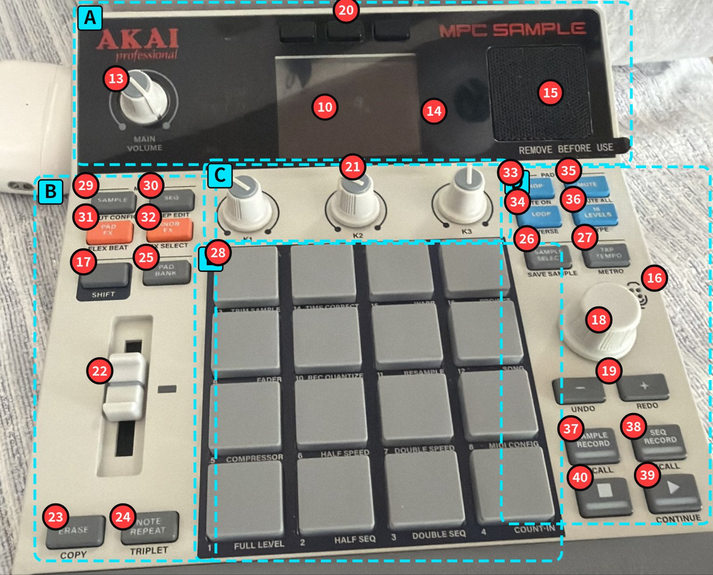

AKAI PROFESSIONAL · AC50 手册 v1.3.0 核对 第一章 已完成

<h1 class="cover-title">MPC Sample</h1>

硬件全图解 · 图文教程

<!-- figure:overview -->

- [**A** 顶部：音量·屏幕·喇叭](chapters/01-functions.md#region-a)
- [**B** 左列：模式·SHIFT·推子](chapters/01-functions.md#region-b)
- [**C** K1–K3 旋钮](chapters/01-functions.md#region-c)
- [**D** 右列：PAD PLAY·走带](chapters/01-functions.md#region-d)
- [**E** 16 垫 + SHIFT](chapters/01-functions.md#region-e)
- [**F** 后面板 + microSD](chapters/01-functions.md#region-f)

照片：你的机器。编号沿用官方手册 Features 章。11、12、14 为指示灯，照片中未亮，位置依官方线稿。⇧ = 按住 SHIFT。（网站上把鼠标停在红色编号上可看到控件名称。）

## 全书大纲

<!-- outline -->

| 章节 | 状态 | 内容 |
|---|---|---|
| [第一章 功能与特点](chapters/01-functions.md) | 已完成 | 1.1 机器定位 · 1.2 规格 · 1.3 面板全图解（A–F 分区）· 1.4 后面板与侧面 · 1.5 顶部面板控件 · 1.6 16 垫 SHIFT 功能 · 1.7 灯光含义 · 1.8 全部屏幕/模式 · 1.9 五分钟上手 · 1.10 待确认 |
| [第二章 打击乐音色、使用场景、写 beat](chapters/02-drums-and-beats.md) | 写作中 | 鼓组构成 · 各鼓件声音与调法 · 使用场景 · 写 beat 七步 · 风格练习 |
| [第三章 采样、速度节奏、beat 风格](chapters/03-sampling-tempo-styles.md) | 写作中 | 采样基础 · SAMPLE RECORD · 编辑 · 节奏 · 风格 |
| [第四章 每个界面的每个旋钮与按键](chapters/04-controls-reference.md) | 写作中 | 编号 1–40 速查 · 各模式全部参数 · SHIFT 组合键速查卡 |
| [第五章 术语表（英中 / 英日）](chapters/05-glossary.md) | 已完成 | 三语表，可切换英中、英日 |

## 资料

- [User Guide v1.3.0 PDF](https://cdn.inmusicbrands.com/akai/sample/MPC%20Sample%20-%20User%20Guide%20-%20v1.3.0%20%28RevA%29.pdf)
- [在线用户指南](https://www.akaipro.com/guides/mpc-sample/index.htm)
- [产品页 · Academy 视频](https://www.akaipro.com/mpc-sample/)
- [官方 FAQ](https://support.akaipro.com/en/support/solutions/articles/69000876967-mpc-sample-frequently-asked-questions)
- [下载 · 固件](https://www.akaipro.com/downloads-and-support/downloads/?product=MPC+Sample)
